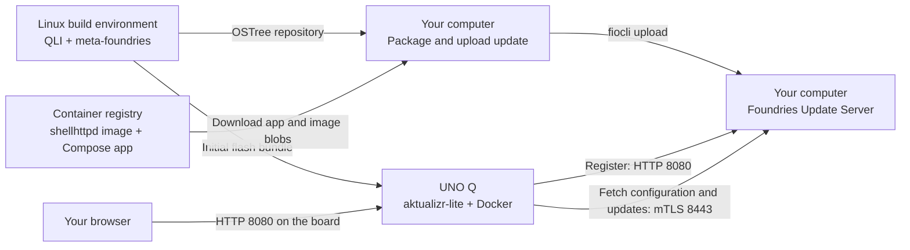

# Set Up UNO Q with Qualcomm Linux and a Local Update Server

Build Qualcomm® Linux® (QLI) for Arduino® UNO Q, connect it to a local Foundries Update Server,
and deliver an update over your local network.
The walkthrough uses the existing Foundries `shellhttpd` example to make application changes visible in a browser.

Follow the four parts in order, using the same guide directory throughout:

1. [Build QLI for UNO Q](build.md): prepare your Linux host and build the image.
2. [Flash UNO Q and connect to the board](flash.md): flash the image and connect through Bughopper or Android Debug Bridge (ADB).
3. [Set up the server and register UNO Q](server-registration.md): initialize the local server, enroll the device, and select applications.
4. [Deploy and update applications](application-updates.md): publish shellhttpd and complete the OS and application update exercises.

The walkthrough includes these checkpoints:

1. [Prepare your x86-64 Linux computer](build.md#prepare-the-build-host).
2. [Build an image with meta-foundries](build.md#build-qli).
3. [Flash and access the board, with or without a Bughopper](flash.md#flash-the-uno-q-and-open-a-shell).
4. [Start the update server on your computer](server-registration.md#start-the-update-server-on-your-computer).
5. [Register your UNO Q](server-registration.md#register-the-uno-q) and [select its applications](server-registration.md#select-the-applications-the-board-should-run).
6. [Publish and roll out the first application](application-updates.md#package-and-deliver-shellhttpd-version-1).
7. [Deliver a second OS and application version, then verify the result](application-updates.md#deliver-os-version-2-and-shellhttpd-version-2).
8. [Add a second application without updating the OS](application-updates.md#add-a-second-application-without-updating-the-os).
9. [Update an existing application without updating the OS](application-updates.md#update-an-existing-application-without-updating-the-os).

> **Validation status:** On 2026-10-13, a hardware walkthrough of guide revision `c71f6af` passed all nine checkpoints on a 4 GB UNO Q with Bughopper and the temporary M-05 workaround.
> It used update server and fiocli built from `e30762e` (`v1.0-rc1-12-ge30762e`).
> The combined OS and application update rebooted and finalized successfully; both application-only changes preserved the OS checksum and boot ID.
> See [the run 3 record](validation.md#run-3-hardware-walkthrough-on-2026-10-13) for the baseline, results, and coverage limits.

The directory, file names, update tag, and build IDs say Wrynose, the release the guide first targeted.
This revision builds from development-branch commits instead; [the build page](build.md#what-is-pinned) explains why.

Before building for a 4 GB board, select the [temporary M-05 memory workaround](build.md#select-the-boards-memory-configuration).
Its use and eventual removal require recording the board and firmware revision.

## Understand the Setup

The computer and board share a local area network (LAN) with Internet access during setup.
The registry is used when packaging applications.
This guide uploads the complete application content to the update server, so the board does not need registry credentials.

The server uses `8080` for its UI and enrollment API, and `8443` for its authenticated device gateway.
The example also uses `8080`, on the **board's IP address**.

## Supporting Pages

- [Troubleshooting](troubleshooting.md)
- [Sources and validation](validation.md)

## References

- [Foundries Update Server quick-start](https://github.com/foundriesio/update-server/blob/e30762e42e3cd45f730be51d2f0e5aaca2b02363/docs/quick-start.md)
- [Building updates and Compose apps](https://github.com/foundriesio/update-server/blob/e30762e42e3cd45f730be51d2f0e5aaca2b02363/docs/build-an-update.md)
- [Uploading updates and creating rollouts](https://github.com/foundriesio/update-server/blob/e30762e42e3cd45f730be51d2f0e5aaca2b02363/docs/updates.md)
- [QLI distro configuration](https://github.com/qualcomm-linux/meta-qcom-distro/tree/acc7f52e830e4308ea97020184cfb8171b0b1d87)
- [meta-foundries integration configuration](https://github.com/foundriesio/meta-foundries/blob/ff40dc16da368d471e890dd19fe945a220ef3ce2/ci/include/base.yml)
- [Foundries shellhttpd example](https://github.com/foundriesio/containers/tree/5be067eb56d1cb59dcbf82568f36986705af9a8a/shellhttpd)
- [Arduino UNO Q manual](https://docs.arduino.cc/tutorials/uno-q/user-manual/)
- [Arduino Bughopper manual](https://docs.arduino.cc/tutorials/bughopper/user-manual/)
